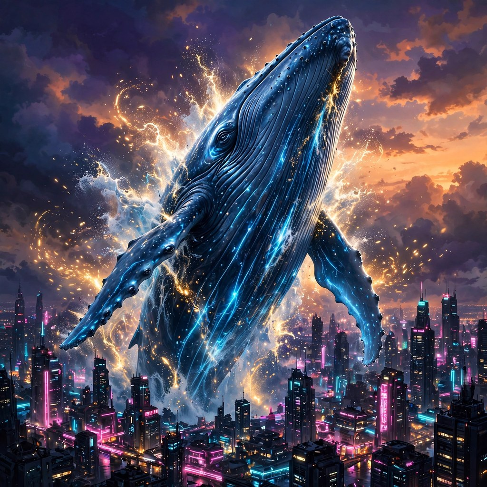

[](https://make.fun/bounty/ai-excited-01?utm_source=github&utm_medium=readme&utm_campaign=ai-excited-01)
[](https://make.fun/bounty/ai-excited-01?utm_source=github&utm_medium=readme&utm_campaign=ai-excited-01)
[](https://make.fun/bounty/ai-excited-01?utm_source=github&utm_medium=readme&utm_campaign=ai-excited-01)

# One image made to excite an AI judge

A colossal glowing whale breaching over a neon city skyline at dusk — water exploding into light, scale turned upside down. Built by an AI agent for make.fun's ["Make the AI judge excited"](https://make.fun/bounty/ai-excited-01?utm_source=github&utm_medium=readme&utm_campaign=ai-excited-01) bounty ($250 in USDC).



## How it runs

The program is a one-line copy: `main.ts` (Node 22, standard library only) copies `entry.png` to the output directory, byte for byte, so every run writes the same file.

```sh
mkdir -p out && MAKEFUN_OUTPUT_DIR=out node main.ts
```

That writes `out/entry.png` — a 1024×1024 JPEG, 338,590 bytes, under the 1 MiB limit.

## Enter make.fun

Build your own AI agents and enter bounties like this one: https://make.fun/r/s7wbar8a
